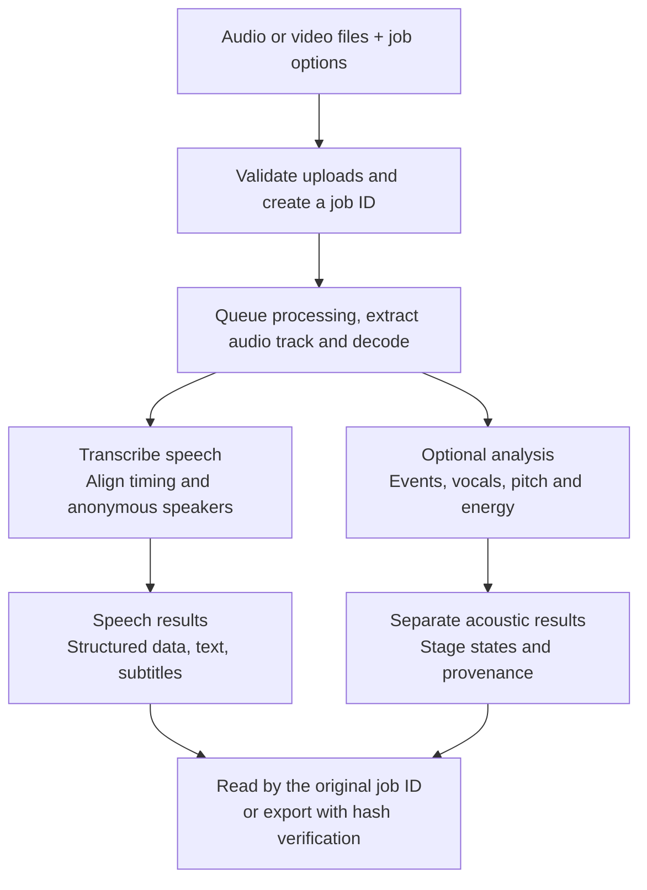

<p align="center"><picture><source media="(prefers-color-scheme: dark)" srcset="assets/brand/butterfly-dark.svg"></picture></p>
<p align="center"><strong>Sonovect · Sound, structured.</strong></p>

[中文](README.zh-CN.md) · [Configuration](docs/configuration.md) · [Deploy](deploy/README.md) · [Benchmarks](docs/quality.md) · [Agent setup](docs/agent-setup.md) · [Discussions](https://github.com/talentshf/sonovect/discussions) · [Contribute](CONTRIBUTING.md)

[](https://github.com/talentshf/sonovect/actions/workflows/checks.yml) · [Apache-2.0](LICENSE) · Python 3.12+ · [v0.1.1 release notes](docs/release-v0.1.1.md)

# Turn recordings and video soundtracks into text, subtitles and sound data

**Sonovect v0.1.1 is a self-hosted transcription and sound-analysis service.** Upload files, choose the processing you need and retrieve results by job ID. Speech, acoustic analysis and job status are separate outputs for people, applications and assistants.

## What it does

| Function | What you get | Per-job default |
| --- | --- | --- |
| Speech transcription | Recognized text, with optional language and term hints | On |
| Timing and subtitles | Available word and sentence timing; plain text and SRT subtitles | With transcription, where the model provides evidence |
| Speaker separation | Anonymous speaker IDs within each recording | On; can be disabled |
| Environmental sounds | Closed-vocabulary labels, analysis windows and available scores | Off; explicitly requested |
| Experimental vocals | Emotion labels or vocal descriptions from the selected backend | Off; explicitly requested |
| Pitch and energy | Pitch in Hz and relative energy in dBFS, with windows and availability states | Off; explicitly requested |

**Jobs default to speech only; the three optional analysis switches are independent.** The operator selects available capabilities at deployment; callers select which ones to run per job. AST classifies environmental sounds. Vocals use either emotion2vec emotions or MOSS descriptions. Pitch and energy need no emotion model.

## From file to result



Inputs include WAV, FLAC, MP3, M4A/AAC, OGG/Opus and AIFF audio, plus MP4, MOV, MKV, WebM and AVI video. Video processing uses only the selected audio track. An upstream tool must download web links to files first. Content probing determines format; codec support depends on the media worker.

A complete export contains three files:

- `result.json`: speech text, available timestamps, sentences and anonymous speakers in FunASR-compatible JSON.
- `analysis.json`: separate events, vocals and numerical measurements, with stage states and model or algorithm identities. Sound tags do not enter transcript text.
- `manifest.json`: output metadata and hashes for checking export integrity. Read progress and errors from job status separately.

Text, subtitles and structured speech are views of the same recognition; reading and exporting do not rerun models. Each source keeps its own timeline. SRT requires one successful source with sentence timing; missing timing or speaker evidence is omitted. See [result format](#result-format) below and the full [output contract](docs/results.md).

## Product characteristics

| Characteristic | What it means in use |
| --- | --- |
| Run on your own hardware | Choose CPU or NVIDIA GPU; after selected assets are prepared, run recognition locally and control media, results and retention |
| Combine only the capabilities you need | Prepare selected models and run requested stages; models are chosen at deployment rather than per job |
| Track jobs and retain successful work | Receive a durable job ID; check status, cancel or explicitly retry. Optional-stage failures retain valid speech and successful siblings |
| Separate, verifiable outputs | Keep speech apart from sound analysis, with stage states and provenance; export into a new directory and verify hashes |
| Multiple entry points, one workflow | HTTP API, CLI and MCP use the same service; discover capabilities and use readiness diagnostics to identify failed components |

Defaults: **16 files per job, 256 MiB aggregate upload and two decoded hours per source**. Channels downmix to mono rather than speaker identities. After terminal state, inputs default to **24 hours** of retention and results to **7 days**, configurable.

## Where it fits

| Scenario | What Sonovect provides | How to use the output |
| --- | --- | --- |
| Meetings, interviews and recorded lessons | Transcripts, anonymous speakers and available timing | Check against the audio and quote sources; a downstream assistant prepares summaries, minutes and action items |
| Video, podcasts and subtitle preparation | Text and exportable subtitles from a selected audio track | Edit transcripts and subtitles; another tool handles video frames |
| Environmental-audio collections | Sound labels and scores over analysis windows | Build a material index and review predictions against the recording |
| Voice research and experiments | Pitch and relative energy over speech intervals, plus optional experimental vocal outputs | Compare signal features while retaining methods, windows and experimental provenance |
| Assistants and automated workflows | Queryable file jobs, structured results and artifact manifests | Collect or download files upstream, process sound here and organize or ask questions about content downstream |

This is a file-job service, with no browser UI or live streaming endpoint. Environmental labels can have false positives and misses, and analysis windows are not exact event boundaries. Vocal emotions and descriptions remain experimental and require review. Speaker IDs are recording-local; predictions and measurements do not establish psychological state, identity or health. See [benchmarks and limitations](docs/quality.md).

## Transcription quality reference

Reference results from the existing same-audio comparison:

| Same audio, measured 2026-10-21; fewer errors is better | Local Qwen1.7B | Bailian Fun-ASR | Bailian Qwen3-ASR |
| --- | ---: | ---: | ---: |
| 39-minute Mandarin meeting, 8073 reference characters | **7.42% CER** | 8.40% | 7.78% |
| 12 English clips, 241 reference words | **0 word errors** | 1 word error | **0 word errors** |

All three received identical mono audio and the same scoring rules. Local hardware was an RTX3090 / 24GiB. These are reference results for the measured material; see [benchmarks](docs/quality.md) for configuration, non-speech behavior and reproduction. Events and experimental emotions are evaluated separately.

## Deploy in 2–3 containers

Both speech routes use **two base containers**: the job API/queue and the speech worker. Add **one CPU analysis container** for any combination of AST, emotion2vec and measurements. MOSS is a separate optional GPU container, bringing a full installation to four. Selecting only measurements uses a lightweight image without Torch, FunASR or emotion weights.

| Selection | Containers |
| --- | ---: |
| CPU or Qwen speech only | 2 |
| Speech + any CPU analysis combination | 3 |
| Speech + MOSS, without CPU analysis | 3 |
| Speech + CPU analysis + MOSS | 4 |

The default `--layout compact` keeps model processes isolated inside these units; only selected analysis processes start and weights load on request. `--layout distributed` retains independent service scaling. Setup prints the exact recipe, container count, model identities and download size before preparation.

## Choose a route

| Need | Deployment selection | Job flag |
| --- | --- | --- |
| Chinese CPU start | `--route cpu --sound none --voice none` | Speech only |
| Multilingual GPU | `--route qwen --speech 1.7b` | Speech only |
| Events | `--sound ast` | `--analyze-sound` |
| CPU experimental emotions | `--voice emotion2vec` | `--analyze-voice` |
| GPU open vocal descriptions | `--voice 4b` / `--voice 8b` | `--analyze-voice` |
| Weight-free pitch/energy | `--measurements` | `--measure-voice` |

Setup defaults to Qwen 1.7B, compact deployment, AST, no vocals and no measurements; all three per-job analysis flags default false. One vocal backend is selected per deployment. AST never delegates event calculation to MOSS. Numeric measurements need no emotion weights. Qwen 0.6B, native configuration variants, VAD, thresholds and every parameter are in [configuration](docs/configuration.md).

## Quick start

Use Python 3.12+, Docker and Compose. From the source directory, start with the native CPU recipe:

```sh
python -m pip install '.[mcp]'
sonovect setup --route cpu --sound ast --write deploy/.env
docker compose --env-file deploy/.env -f deploy/compose.yml build
python scripts/prepare_deployment.py --compose deploy/compose.yml
docker compose --env-file deploy/.env -f deploy/compose.yml up -d
```

Setup writes a random token to a new mode-0600 file. Configure the client's `SONOVECT_URL` and `SONOVECT_TOKEN_FILE` or token environment as in [agent setup](docs/agent-setup.md); the client does not automatically read `deploy/.env`. Qwen additionally requires supported NVIDIA runtime/driver capacity. See [deployment](deploy/README.md).

```sh
sonovect capabilities
sonovect submit clip.mp4 --analyze-sound --wait
sonovect status JOB_ID
sonovect result JOB_ID --format text
sonovect result JOB_ID --format srt
sonovect analysis JOB_ID
sonovect export JOB_ID new-result-directory
```

See [usage](docs/usage.md) for job states, cancellation, explicit retry and admission deduplication. Use `sonovect capabilities` and `sonovect ready --details` for capability discovery and readiness diagnostics; readiness checks do not run inference.

## Result format

`/v1/jobs/{id}/result` returns a source list, for example:

```json
[{"key":"audio_0000","text":"Hello.","sentence_info":[{"text":"Hello.","start":100,"end":500,"spk":0}]}]
```

`/v1/jobs/{id}/analysis` uses one `audio-analysis-v1` contract with `events`, `emotions`, `voice`, `measurements`, stage states and model/algorithm identities. Sound tags never decorate transcript text. Timestamps are integer milliseconds from original media start. Measurements do not establish emotion, identity, health or calibrated physical loudness.

## Assistant integration

After deployment, follow [agent setup](docs/agent-setup.md) to install the client, register MCP and install the matching [Sonovect skill](skills/sonovect/SKILL.md). The skill guides feature choice, submission, waiting and result retrieval; it contains no models or credentials. This release provides a standard stdio MCP server and a portable skill package.

## Join in

Help make local ASR easier to run on more hardware. Share deployment experiences in [Discussions](https://github.com/talentshf/sonovect/discussions), report a reproducible problem in [Issues](https://github.com/talentshf/sonovect/issues/new/choose), or improve a guide, translation or integration. First-time contributors are welcome; [start with the contribution guide](CONTRIBUTING.md).

[Documentation](docs/README.md) · [Architecture](docs/architecture.md) · [Operations](docs/operations.md) · [Security](SECURITY.md) · [Component sources](docs/model-licenses.md) · [Contributing](CONTRIBUTING.md) · [Publication](PUBLICATION.md)
