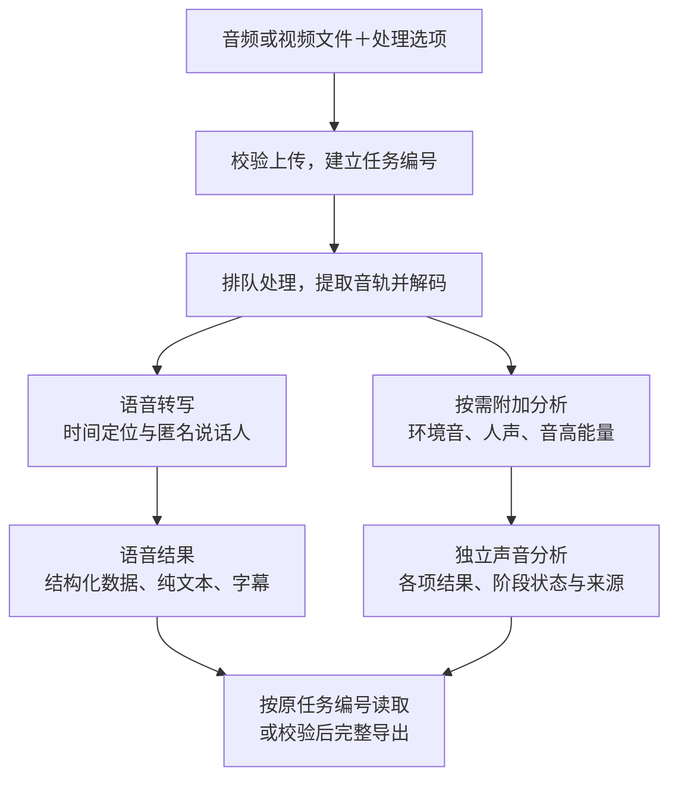

<p align="center"><picture><source media="(prefers-color-scheme: dark)" srcset="assets/brand/butterfly-dark.svg"></picture></p>
<p align="center"><strong>Sonovect · Sound, structured.</strong></p>

[English](README.md) · [完整配置](docs/configuration.zh-CN.md) · [部署](deploy/README.md) · [测试参考](docs/quality.zh-CN.md) · [智能体接入](docs/agent-setup.zh-CN.md) · [交流讨论](https://github.com/talentshf/sonovect/discussions) · [参与贡献](CONTRIBUTING.md#中文)

[](https://github.com/talentshf/sonovect/actions/workflows/checks.yml) · [Apache-2.0](LICENSE) · Python 3.12+ · [v0.2.0 发行介绍](docs/release-v0.2.0.md)

# 把录音和视频音轨，变成文字、字幕和声音数据

**Sonovect v0.2.0 是本地部署的音视频转写与声音分析服务。** 上传文件，选择要做的处理，再按任务编号取回结果。语音正文、声音分析和任务状态分别读取，便于人直接使用，也便于软件和助手继续处理。

v0.2.0 另提供默认关闭的 [DashScope（百炼服务协议）兼容异步文件接口](docs/filetrans-compatibility.zh-CN.md)，供应用提交受控音频地址并按原任务编号恢复结果。

**开发源码新增：** 服务与 CLI（命令行）可选 Qwen 或 VibeVoice Streaming 1.5B（流式小版）实时识别。**1.5B 作为备选，独立环境按需运行，不自动重启、不加入默认常驻部署；文件转写默认仍为 Qwen。** 这些扩展尚未包含在 v0.2.0 正式发行中，见[实时识别与独立的 VibeVoice 文件适配](docs/vibevoice-realtime.zh-CN.md)。

## 能做什么

| 功能 | 得到什么 | 单次任务默认 |
| --- | --- | --- |
| 语音转写 | 识别正文，可提供语言提示和热词 | 开启 |
| 时间定位与字幕 | 可用的字词、句段起止时间；纯文本和 SRT（字幕格式） | 随转写提供，取决于模型证据 |
| 区分说话人 | 本次录音内的匿名说话人编号 | 开启，可关闭 |
| 环境音分析 | 固定词表中的声音标签、分析窗口和可用分数 | 关闭，需单独开启 |
| 实验性人声分析 | 所选后端的情绪标签或人声描述 | 关闭，需单独开启 |
| 音高与能量测量 | 音高 Hz（赫兹）、相对能量 dBFS（相对数字满幅分贝），带时间窗口和可用状态 | 关闭，需单独开启 |

**默认只做语音转写；三项附加分析分别选择，不会互相自动开启。** 部署者先选择要提供哪些能力，调用者再选择本次执行哪些功能。环境音使用 AST（声音分类模型）；人声选择 emotion2vec（情绪模型）或 MOSS（人声描述模型）；音高和能量无需情绪模型。

## 从文件到结果



输入支持 WAV、FLAC、MP3、M4A/AAC、OGG/Opus、AIFF 等音频，以及 MP4、MOV、MKV、WebM、AVI 等视频。视频只处理选定音轨；网页链接由上游先下载成文件。按内容探测格式，实际编码支持取决于媒体工作器。

完整导出包含三份文件：

- `result.json`：语音正文、可用时间戳、句段和匿名说话人，采用 FunASR（语音识别框架）兼容的 JSON（结构化数据）格式。
- `analysis.json`：独立环境音、人声和数值测量，以及各阶段状态和模型或算法来源。声音标签不插入语音正文。
- `manifest.json`：产物清单与校验摘要，用于核对导出文件是否完整。任务进度和错误另从任务状态读取。

纯文本、字幕和结构化语音结果来自同一次识别；查询或导出不会重新运行模型。多文件各有自己的时间轴，字幕要求单一成功来源且具备句级时间；缺失的时间或说话人信息不补造。字段示例见下方[结果格式](#结果格式)，完整合同见[输出说明](docs/results.md)。

## 产品特性

| 特性 | 对使用者的意义 |
| --- | --- |
| 在自己的硬件上运行 | 可选 CPU（处理器）或 NVIDIA GPU（图形处理器）；准备好所选模型后可本地识别，掌握媒体、结果和保留期限 |
| 功能按需组合 | 只准备选中的模型，只执行任务请求的分析；模型在部署时选定，单次任务无需挑模型 |
| 任务可追踪，成功部分可保留 | 提交后拿到持久任务编号，可查状态、取消、明确重跑；可选分析失败时保留有效语音及其他成功结果 |
| 输出分层，可校验导出 | 正文和声音分析分开，保留阶段状态与来源；用新目录导出并检查文件摘要 |
| 多种接入方式，共用任务流程 | HTTP（网络接口）、CLI（命令行）和 MCP（模型上下文协议）连接同一服务；可查询能力，并用就绪诊断定位失败组件 |

默认每任务最多 **16 个文件、总计 256 MiB、每文件解码两小时**；声道下混单声道，不将声道当作说话人。任务终态后输入默认保留 **24 小时**，结果保留 **7 天**，均可配置。

## 适合哪些场景

| 场景 | Sonovect 提供什么 | 后续怎么使用 |
| --- | --- | --- |
| 会议、访谈、课程录音 | 正文、匿名说话人和可用时间信息 | 回听核对、引用原话；摘要、纪要和待办由上层助手继续整理 |
| 视频、播客与字幕制作 | 选定音轨的文字和可导出的字幕 | 校订文稿、制作字幕；视频画面由其他工具处理 |
| 环境声素材整理 | 按分析窗口给出的声音标签和分数 | 建立素材索引，结合原音审听复核 |
| 声音研究与人声实验 | 有语音片段的音高、相对能量及可选实验人声结果 | 比较声音特征，保留算法、窗口和实验来源 |
| 助手与自动化流程 | 可查询的文件任务、结构化结果和产物清单 | 上游下载或收集文件，Sonovect 处理声音，下游助手做内容整理和问答 |

默认采用文件任务方式，没有浏览器操作台。环境音可能误报、漏报，输出窗口不等于精确事件边界；人声情绪和描述保持实验性质，需复核。匿名编号只在本次录音内有效，情绪预测和信号数值不能用于断言真实心理状态、身份或健康。具体限制见[测试参考](docs/quality.zh-CN.md)。

## 可选实时识别（开发源码）

`sonovect stream` 接收单声道16kHz、16位整数 WAV（音频容器），或持续输入的 PCM（原始采样），逐次输出可替换草稿，结束后返回定稿。Qwen 路线提供文字；VibeVoice Streaming 1.5B 还保留模型原生匿名说话人标签，不提供时间戳。当前没有浏览器录音页面。

1.5B 的完整模型文件约 **5.64GB**。RTX3090／24GiB 的一次英文短样例中，PyTorch（张量框架）预留显存峰值约 **5.14GiB**，不包含其他显卡分配。这是短样例测量，不能当作长会话容量保证；中文会议效果和分人准确率尚未验收。[运行指南](docs/vibevoice-realtime.zh-CN.md#新增-vibevoice-streaming-15b流式小版)列出了中文样例误识别及测量限制。

需要时显式启动独立容器，前台运行，退出后自动删除；不加入默认文件服务编排。模型加载后会驻留在该进程内，停止进程才释放。使用前需准备并验证隔离镜像。

## 转写质量参考

以下为 2026-10-21 已有同素材对照，完整条件和限制见测试参考：

| 2026-10-21 同素材对照，错误越少越好 | 本地 Qwen1.7B | 百炼 Fun-ASR | 百炼 Qwen3-ASR |
| --- | ---: | ---: | ---: |
| 39分钟中文会议，8073参考字符 | **7.42%** | 8.40% | 7.78% |
| 12段英文，241参考词 | **0词错误** | 1词错误 | **0词错误** |

三者使用相同单声道音频和评分规则；本地硬件为 RTX3090 / 24GiB。结果是所测素材的参考值，具体配置、非语音表现和复现方法见[测试参考](docs/quality.zh-CN.md)。环境音与实验情绪单独评测。

## 常用部署只需2～3个容器

CPU与Qwen两条语音路线都以**接口/任务队列、语音处理两个容器**起步。需要AST环境音、emotion2vec或音高能量时，增加**一个CPU附加分析容器**，功能可以自由组合。MOSS继续作为独立可选显卡容器，全配最多四个。只选音高能量时使用不含Torch、FunASR和情绪权重的轻量镜像。

| 选择 | 容器数 |
| --- | ---: |
| CPU或Qwen，只转写 | 2 |
| 转写＋任意CPU附加分析组合 | 3 |
| 转写＋MOSS，不选CPU附加分析 | 3 |
| 转写＋CPU附加分析＋MOSS | 4 |

默认`--layout compact`（紧凑部署）保留容器内部的模型进程隔离；只启动选中的分析模块，收到相应任务才加载权重。需要独立扩容时可选`--layout distributed`（分服务部署）。配置生成会列出对应配方、容器数量、模型身份和下载体积。

## 如何选

| 需求 | 部署选项 | 单次任务 |
| --- | --- | --- |
| 中文、无显卡起步 | `--route cpu --sound none --voice none` | 默认只转写 |
| 多语与显卡 | `--route qwen --speech 1.7b` | 默认只转写 |
| 环境音 | `--sound ast` | `--analyze-sound` |
| CPU实验情绪 | `--voice emotion2vec` | `--analyze-voice` |
| GPU开放式人声描述 | `--voice 4b` / `--voice 8b` | `--analyze-voice` |
| 无权重音高、能量 | `--measurements` | `--measure-voice` |

配置生成默认选Qwen1.7B、紧凑部署和AST，人声与测量关闭；任务三个附加开关均关闭。一个部署选一个人声后端；AST不借MOSS重复分类，数值测量无需情绪模型。Qwen0.6B、Paraformer配置与VAD（语音活动检测）的替代选项、阈值和全部参数见[完整选型表](docs/configuration.zh-CN.md)。

## 快速开始

需要Python3.12或更新版本、Docker（容器工具）及Compose（编排插件）。从源码目录执行，CPU路线：

```sh
python -m pip install '.[mcp]'
sonovect setup --route cpu --sound ast --write deploy/.env
docker compose --env-file deploy/.env -f deploy/compose.yml build
python scripts/prepare_deployment.py --compose deploy/compose.yml
docker compose --env-file deploy/.env -f deploy/compose.yml up -d
```

配置文件含随机令牌，权限0600。客户端通过部署者配置的 `SONOVECT_URL` 与 `SONOVECT_TOKEN_FILE`（或令牌环境变量）连接；客户端不会自动读取 `deploy/.env`。完整连接示例见[智能体与客户端接入](docs/agent-setup.zh-CN.md)。Qwen路线另需受支持NVIDIA环境，见[部署手册](deploy/README.md)。

```sh
sonovect capabilities
sonovect submit clip.mp4 --analyze-sound --wait
sonovect status JOB_ID
sonovect result JOB_ID --format text
sonovect result JOB_ID --format srt
sonovect analysis JOB_ID
sonovect export JOB_ID new-result-directory
```

任务状态、取消、明确重跑及防重复提交见[使用说明](docs/usage.zh-CN.md)。能力和就绪诊断分别使用 `sonovect capabilities`、`sonovect ready --details`；就绪检查不执行模型推理。

## 结果格式

语音接口 `/v1/jobs/{id}/result` 返回来源列表：

```json
[{"key":"audio_0000","text":"你好。","timestamp":[[100,450]],"sentence_info":[{"text":"你好。","start":100,"end":500,"spk":0}]}]
```

这是格式示例。附加接口 `/v1/jobs/{id}/analysis` 统一使用 `audio-analysis-v1`，包含 `events`、`emotions`、`voice`、`measurements`，以及每阶段状态和模型/算法身份。声音标签不插入正文，时间均为原媒体起点的整数毫秒。数字信号测量不等于真实情绪、身份、健康或校准响度。

## 助手接入与开发

部署完成后，按[智能体接入指南](docs/agent-setup.zh-CN.md)安装客户端、配置 MCP 并安装同版本 [Sonovect技能](skills/sonovect/SKILL.md)。技能指导智能体选型、提交、等待和读取结果；它不包含模型或凭据。发行提供标准 MCP 服务和独立技能包，使用支持本地标准输入输出的智能体即可接入。

## 一起参与

欢迎一起让本地语音识别更容易部署、适配更多硬件。可以到[讨论区](https://github.com/talentshf/sonovect/discussions)分享部署经验，在[问题区](https://github.com/talentshf/sonovect/issues/new/choose)报告可复现的问题，也可以完善指南、翻译或已有接入方式。第一次参与开源也欢迎，从[贡献指南](CONTRIBUTING.md#中文)开始即可。

[文档导航](docs/README.md) · [架构](docs/architecture.md) · [运维](docs/operations.md) · [安全](SECURITY.md) · [组件来源](docs/model-licenses.md) · [开发贡献](CONTRIBUTING.md) · [发行状态](PUBLICATION.md)
