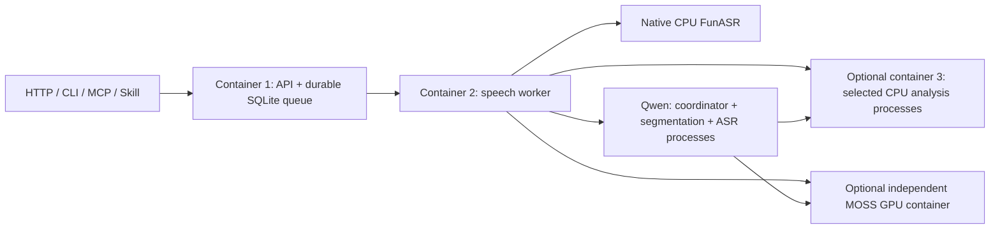

# Architecture and responsibility

Compact is the default single-host layout: two base containers, one optional CPU analysis container, and optional MOSS. FunASR and Qwen are alternative speech selections. Analysis starts only enabled AST, emotion2vec and numerical processes; MOSS is selected instead of emotion2vec. The measurements-only image contains no model frameworks or weights. Model assets are prepared separately at pinned revisions, verified and loaded lazily on requested inference.

The API authenticates, validates and admits durable jobs. The speech container owns bounded media decoding and queue processing. Qwen uses separate supervised coordinator, segmentation and ASR processes with a shared reviewed dependency closure; segmentation and ASR bind only loopback. Separate processes preserve lazy model state and GPU unload boundaries. The supervisor starts the queue worker only after helpers are ready, monitors every child, drains the queue worker before stopping helpers and fails the unit if a child exits. Container restart preserves durable jobs and leases. CPU analysis processes share one container resource ceiling but retain independent endpoints, thread controls, errors and request counters. A failed analysis stage leaves successful speech and sibling results available.

`--layout distributed` is an explicit advanced option for independent service placement/scaling. It uses the same source, pinned models and job/result contracts. Container boundaries are deployment choices; no client owns a second queue or bypasses the job API. The external-provider recipe delegates model processing to an explicitly compatible private coordinator.

AST always owns environmental tags. One vocal backend is selected per deployment: CPU emotion2vec or independent GPU MOSS. Numerical processing requires no weights and reuses existing speech intervals. Qwen unload is confirmed before MOSS starts; MOSS releases its GPU model after requests by default. Combining containers does not reduce weight size or promise lower latency. Internal HTTP serialization remains between isolated model processes.

Speech and analysis artifacts are separate, immutable on retrieval and checked during export. Models, job data, configuration and source have separate storage responsibilities. This repository contains current product source, docs, contracts, tests and `skills/sonovect`; private planning and retired development material live outside the product tree.
